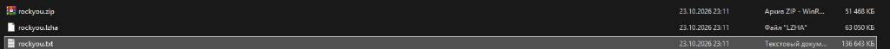
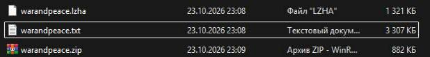
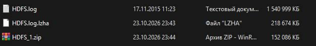

# LZHA

LZHA is a small experimental lossless archiver written in C++. It uses a simple LZ77 match finder followed by Huffman coding and writes archives in a custom `.lzha` format.

The project is primarily for learning and experimentation. It works for normal files, but the current implementation is not designed for large inputs or production use.

[Русская версия](README.ru.md)

## Build

The source requires C++17 or newer. Native build on macOS or Linux:

```bash
clang++ -std=c++20 -O2 -Wall -Wextra -pedantic lzha.cpp -o lzha
```

Windows PE build from macOS with MinGW-w64:

```bash
x86_64-w64-mingw32-g++ -std=c++20 -O2 -static -static-libgcc -static-libstdc++ lzha.cpp -o lzha.exe
```

## Usage

```text
lzha [compress|decompress] <input> <output>
```

Compress a file:

```bash
./lzha compress input.bin output.lzha
```

Decompress an archive:

```bash
./lzha decompress output.lzha restored.bin
```

The program does not infer the operation from the file extension. The mode must be specified explicitly.

## Implementation

The compressor has two stages:

1. LZ77 replaces repeated sequences with `(offset, length)` matches.
2. Huffman coding encodes literals and match-length symbols into a bitstream.

Current LZ77 parameters:

| Parameter | Value |
|---|---:|
| Search window | 4096 bytes |
| Minimum match | 3 bytes |
| Maximum match | 258 bytes |
| Candidate chain limit | 64 |
| Match offset | 12 bits |

The archive starts with the `LZHA` magic, a version byte, and the frequency table used to rebuild the Huffman tree. The rest of the file is the encoded bitstream with an end marker.

## Benchmarks

The following is a local size comparison on macOS ARM64. Sizes are exact byte counts. The ZIP column was produced with the system `zip` utility. This is not a speed benchmark.

| Input | Original | ZIP | LZHA | Compression (%) (ZIP / LZHA) |
|---|---:|---:|---:|---:|
| `rockyou.txt` | 139,921,497 B | 53,357,216 B | 64,562,443 B | 38.13% / 46.14% |
| `warandpeace.txt` | 3,386,080 B | 914,033 B | 1,351,949 B | 26.99% / 39.93% |
| `HDFS.log` | 1,577,982,906 B | 155,658,613 B | 223,922,141 B | 9.86% / 14.19% |

The percentage is the compressed size as a share of the original size; lower is better.

For these inputs, LZHA produces larger archives than ZIP. Improving the ratio is one of the next tasks for the project.

<details>
<summary>Benchmark screenshots</summary>







</details>

## Verification

The basic correctness check is a round trip followed by a byte comparison:

```bash
./lzha compress path/to/input.txt /tmp/input.lzha
./lzha decompress /tmp/input.lzha /tmp/input.restored
cmp path/to/input.txt /tmp/input.restored
```

This check was run locally on `warandpeace.txt`, `rockyou.txt`, and small binary fixtures. The benchmark datasets are not part of the public repository.

## Limitations

The compressor currently reads the whole input into memory. The LZ77 matcher also allocates `prev` with one `int` per input byte. The token stream and the encoded bitstream are kept in memory at the same time.

For the 1.58 GB `HDFS.log` file, `prev` alone takes about 6.31 GB (5.88 GiB). The observed peak during compression was about 9.5 GB. Decompression builds the complete output in memory before writing it.

The intended fix is chunked or streaming processing with a bounded sliding window. That requires a larger redesign: matches must work across chunk boundaries, Huffman metadata must be handled without retaining the whole token stream, and the decoder must preserve its history window. It is not a small local change to the current implementation.

Other current limitations:

- Empty input files are not supported.
- Archives do not contain a checksum.
- Validation of malformed archives is limited.
- Integer fields use the host byte order.
- There are no automated tests or CI checks yet.

## Repository Layout

```text
lzha.cpp       # implementation and CLI
README.md      # English documentation
README.ru.md   # Russian documentation
benchmarks/    # benchmark screenshots
```

The large benchmark inputs are kept locally and are intentionally not uploaded. GitHub rejects individual files over 100 MB, and `rockyou.txt` is a well-known leaked password list. The screenshots and measurements are enough to reproduce the context without redistributing the datasets.

## License

No open-source license has been added yet.
